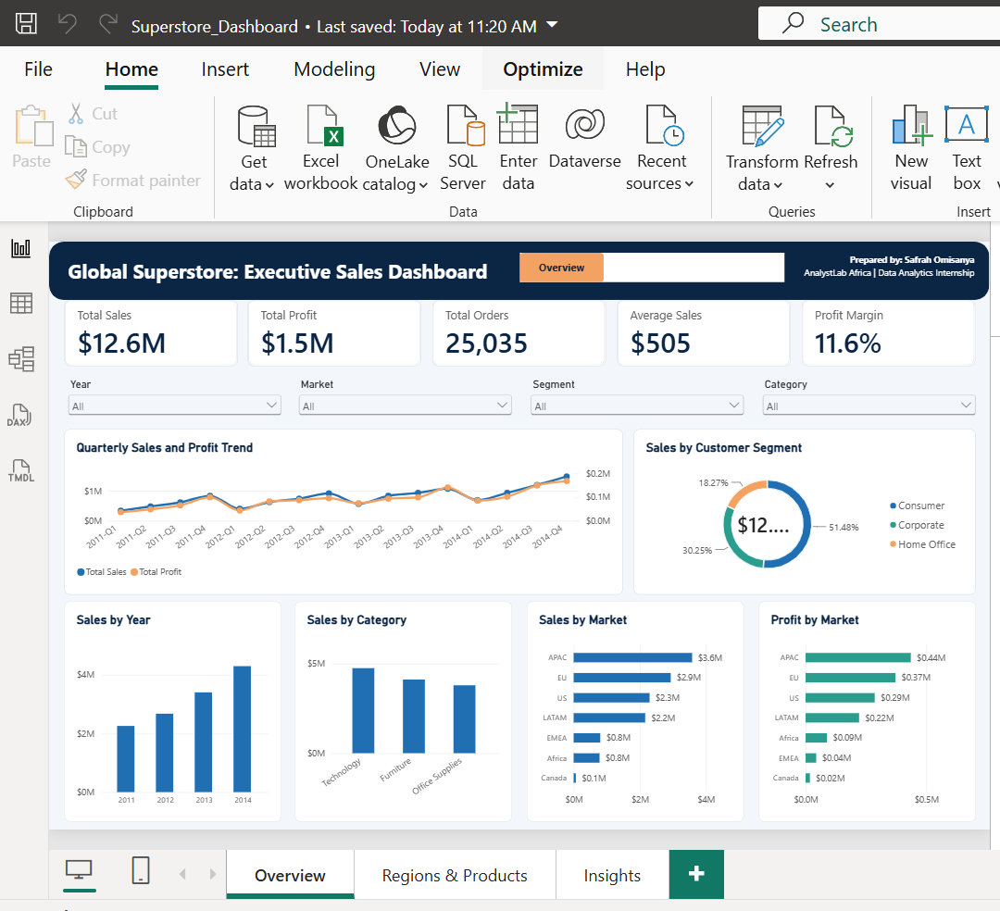
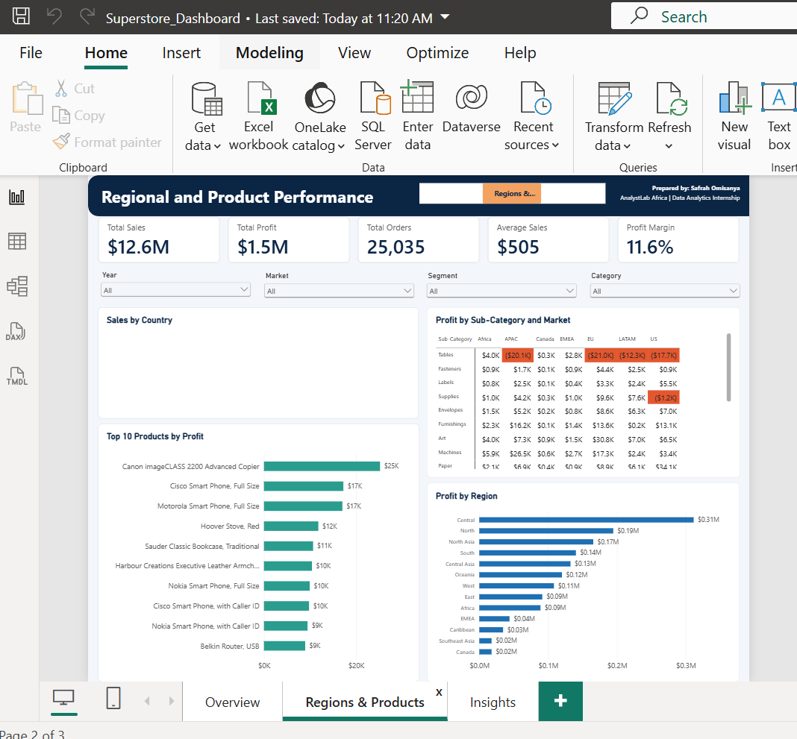
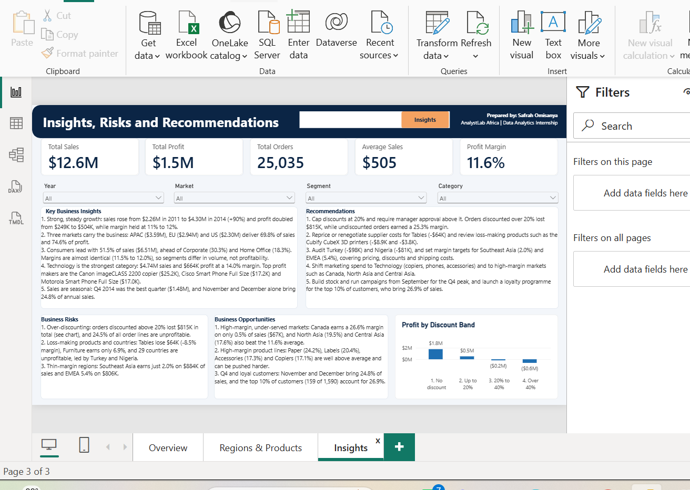

# Global Superstore: Executive Sales Dashboard (Power BI)

**AnalystLab Africa | Data Analytics Internship | Week 2: Business Analytics Case Study**
Prepared by **Safrah Omisanya**

An interactive three-page Power BI dashboard that helps management monitor sales, profitability, customer segments and regional performance, and turns the findings into actionable recommendations.

## Business Problem

A national retail company needs an executive dashboard to monitor sales performance, profitability, customer behaviour and regional performance. The dashboard answers seven questions:

1. What is the overall sales performance of the company?
2. Which regions generate the highest sales and profit?
3. Which customer segments contribute the most revenue?
4. Which product categories perform best?
5. Which products are the most profitable?
6. What trends can be observed over time?
7. What should management do to improve performance?

## Dataset

**Global Superstore** ([Kaggle](https://www.kaggle.com/datasets/apoorvaappz/global-super-store-dataset)): 51,290 order lines (25,035 distinct orders), 1,590 customers, 7 markets, 147 countries, 3 categories and 17 sub-categories, covering 2011 to 2014.

## Dashboard Pages

| Page | Content |
|---|---|
| **Overview** | 5 KPI cards, 4 slicers, quarterly sales and profit trend (line), sales by segment (donut), sales by year and category (columns), sales and profit by market (bars) |
| **Regions & Products** | Sales by country (map), profit by sub-category and market (matrix with loss cells in red), top 10 products by profit (bar), profit by region (bar) |
| **Insights** | 5 key insights, 3 risks, 3 opportunities, 5 recommendations and a profit-by-discount-band chart |

### Screenshots





## Data Preparation (Power Query)

- Imported the CSV with Western European (1252) encoding to keep special characters intact.
- Profiled all columns on the entire dataset and checked missing values: only **Postal Code** has gaps (81% empty, because most countries outside the US have no postal code). It was kept and typed as text.
- Converted **Order Date** and **Ship Date** from text to date using the **English (United Kingdom)** locale, since the source dates are day-month-year.
- Checked for duplicate records across all columns except Row ID: **none found**, 51,290 rows retained.
- Verified numeric types (Sales, Profit, Discount, Shipping Cost as decimal; Quantity as whole number).
- Created **Order Year**, **Month Number**, **Month Name** and **Ship Days** columns.
- Built a **Calendar** date table (marked as the date table) related to Order Date, plus Year-Quarter.
- Created a **Discount Band** column to analyse the effect of discounting on profit.

## DAX Measures

```
Total Sales   = SUM(Orders[Sales])
Total Profit  = SUM(Orders[Profit])
Total Orders  = DISTINCTCOUNT(Orders[Order ID])
Average Sales = DIVIDE([Total Sales], [Total Orders])
Profit Margin = DIVIDE([Total Profit], [Total Sales])
Profit Colour = IF([Total Profit] < 0, "#E4572E", "#FFFFFF")
```

## Key Results

| KPI | Value |
|---|---|
| Total Sales | $12.64M |
| Total Profit | $1.47M |
| Total Orders | 25,035 |
| Average Sales per Order | $505 |
| Profit Margin | 11.6% |

## Key Insights

1. Sales grew from $2.26M (2011) to $4.30M (2014), and profit doubled from $249K to $504K, with margin steady at 11% to 12%.
2. APAC, EU and US deliver 69.8% of sales and 74.6% of profit.
3. Consumers bring 51.5% of sales; segment margins are almost identical (11.5% to 12.0%).
4. Technology is the strongest category: $4.74M sales at a 14.0% margin, versus 6.9% for Furniture.
5. Sales peak in Q4 (November and December = 24.8% of annual sales), and profit turns negative once discounts pass 20%.

## Risks and Opportunities

- **Risks:** orders discounted above 20% lost $815K; Tables lose $64K and 29 countries are unprofitable (Turkey and Nigeria worst); Southeast Asia (2.0%) and EMEA (5.4%) have thin margins.
- **Opportunities:** high-margin markets (Canada 26.6%, North Asia 19.5%, Central Asia 17.6%); high-margin products (Paper, Labels, Accessories, Copiers); Q4 demand and the top 10% of customers (26.9% of sales).

## Recommendations

1. Cap discounts at 20% and require approval above it.
2. Reprice Tables and review loss-making products such as the Cubify CubeX 3D printers.
3. Audit unprofitable countries and thin-margin regions.
4. Shift marketing and stock investment to Technology and high-margin markets.
5. Plan stock and campaigns around the Q4 peak and launch a loyalty programme for top customers.

## Repository Structure

```
.
├── README.md
├── data/        Global_Superstore2.csv (or the Kaggle link above)
├── dashboard/   Superstore_Dashboard.pbix, Superstore_Dashboard.pdf, page screenshots (PNG)
└── reports/     BI_Overview_Report.docx, Executive_Summary_Report.docx
```

## How to Open

1. Install [Power BI Desktop](https://powerbi.microsoft.com/desktop/) (free, Windows).
2. Open `dashboard/Superstore_Dashboard.pbix`.
3. Use the slicers (Year, Market, Segment, Category) and the page navigator in the header to explore.

## Skills Demonstrated

Power BI, Power Query, DAX, data cleaning and profiling, data modelling (date table), dashboard design, data visualisation, business analysis and executive reporting.

---
#AnalystLabAfrica
